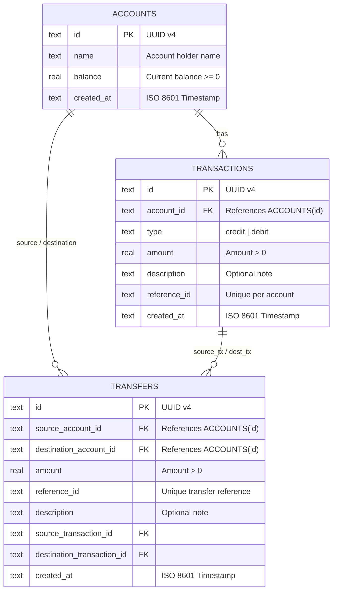

# 💳 Transaction Ledger API

[](https://www.typescriptlang.org/)
[](https://nodejs.org/)
[](https://expressjs.com/)
[](https://www.sqlite.org/)
[]()

> Backend API for a robust, strictly consistent **Transaction Ledger System** developed for the **Walnut Folks / Confluencr Full Stack Developer Assessment**.

---

## 🌟 Key Features

1. **Account Management**
   - Create accounts with auto-generated UUIDs and timestamps.
   - Guaranteed initial balance of `0.00` (clients cannot tamper with initial balances).
   - Real-time balance lookup.

2. **Credit & Debit Transactions**
   - **Credit:** Atomically increases account balance.
   - **Debit:** Atomically decreases account balance with strict **overdraft prevention** (`INSUFFICIENT_BALANCE` if `balance < amount`).
   - **Duplicate Detection / Idempotency:** Composite uniqueness on `(account_id, reference_id)` ensures the same transaction reference cannot be applied twice to the same account. The same reference ID remains valid across different accounts.

3. **Data Integrity & Atomicity**
   - Transaction insertion and account balance updates are executed inside **ACID-compliant SQLite transactions**.
   - Database-level constraints (`CHECK (balance >= 0)`, foreign key enforcement).
   - **Transaction Immutability:** Transactions are append-only; no update or delete routes exist.

4. **Transaction History & Pagination**
   - **Filtering:** Filter transactions by type (`credit`, `debit`).
   - **Sorting:** Guaranteed **latest-first ordering** based on `created_at DESC`.
   - **Pagination:** Structured metadata (`page`, `limit`, `total_records`, `total_pages`).

5. **Bonus: Multi-Account Money Transfer**
   - Atomically transfers money from Account A to Account B.
   - Verifies sufficient balance on the source account and validity of both accounts.
   - Debits source and credits destination in a single atomic database transaction; full rollback if any error occurs.
   - Generates corresponding ledger entries for both accounts with transfer references.

6. **Interactive Documentation & API Explorer**
   - **Swagger UI** available at `/docs` with interactive request runner.
   - OpenAPI 3.0 specification available at `/docs.json`.

---

## 🏗️ Architecture & Database Design

### Layered Architecture
```
src/
├── config/              # Environment & configuration management
├── database/            # SQLite connection, pragmas, schema migrations
├── errors/              # Standardized error codes and custom AppError classes
├── middleware/          # Request validation (Zod), error handler, logging
├── modules/
│   ├── accounts/        # Controller, Service, Repository, Validation, Types
│   ├── transactions/    # Controller, Service, Repository, Validation, Types
│   └── transfers/       # Bonus: Atomic multi-account transfer module
├── routes/              # Centralized route registration (/api/v1 and root)
├── docs/                # OpenAPI 3.0 YAML specification
├── app.ts               # Express application builder
└── server.ts            # Application entrypoint & graceful shutdown
```

### Database Entity-Relationship Diagram



---

## 🛠️ Tech Stack

- **Runtime:** [Node.js](https://nodejs.org/) (v20+ / v22+ / v24+)
- **Language:** [TypeScript 5](https://www.typescriptlang.org/) (ES2022, NodeNext modules)
- **Web Framework:** [Express 4](https://expressjs.com/)
- **Database:** [SQLite](https://www.sqlite.org/) via [`better-sqlite3`](https://github.com/WiseLibs/better-sqlite3) (Zero external database installation needed, true ACID atomicity)
- **Validation:** [Zod](https://zod.dev/)
- **Testing:** [Vitest](https://vitest.dev/) & [Supertest](https://github.com/ladjs/supertest)
- **Documentation:** [Swagger UI Express](https://github.com/scottie1984/swagger-ui-express) & OpenAPI 3.0

---

## 🚀 Getting Started

### 1. Prerequisites
- **Node.js** (v18.0.0 or higher; v20/v22/v24 recommended)
- **npm** (v9.0.0 or higher)

### 2. Installation
Clone the repository and install dependencies:
```bash
git clone <repo-url>
cd confluencr
npm install
```

### 3. Environment Configuration
Create a `.env` file (or copy from `.env.example`):
```bash
cp .env.example .env
```
Default `.env` configuration:
```env
PORT=3000
NODE_ENV=development
DB_PATH=./ledger.db
LOG_LEVEL=info
```

### 4. Running the Application

#### Development Mode (with hot-reload):
```bash
npm run dev
```

#### Production Build & Run:
```bash
npm run build
npm start
```

The server will start at:
- **API Base:** `http://localhost:3000`
- **Swagger Documentation:** `http://localhost:3000/docs`
- **Health Check:** `http://localhost:3000/health`

---

## 🧪 Running Automated Tests

A comprehensive test suite of **38 automated tests** covering accounts, transactions, edge cases, error codes, pagination, atomicity rollback, concurrency, and money transfers is included:

```bash
# Run all tests once
npm test

# Run tests in watch mode
npm run test:watch
```

### Test Suite Breakdown
| Test Suite | Purpose |
|:---|:---|
| `accounts.test.ts` | Account creation, zero initial balance enforcement, balance retrieval, 404 handling |
| `transactions.test.ts` | Credit/debit operations, overdraft protection, duplicate reference rejection, input validation |
| `pagination.test.ts` | Latest-first sorting (`created_at DESC`), filtering by credit/debit, offset/limit pagination |
| `atomicity.test.ts` | Multi-step transaction consistency (prompt example), rollback on failure, immutability check |
| `transfers.test.ts` | Bonus: atomic multi-account fund transfer, insufficient balance rollback, duplicate check |
| `concurrency.test.ts` | Race condition tests: 10 concurrent debit requests serialize safely without overdrafting |

---

## 📡 API Overview

| Method | Endpoint | Description | Status Codes |
|:---:|:---|:---|:---:|
| `POST` | `/accounts` | Create a new account (initial balance = 0) | `201`, `400` |
| `GET` | `/accounts` | List all accounts | `200` |
| `GET` | `/accounts/:id` | Get account details by ID | `200`, `404` |
| `GET` | `/accounts/:id/balance` | Get account current balance | `200`, `404` |
| `POST` | `/transactions` | Add a credit or debit transaction | `201`, `400`, `404`, `409`, `422` |
| `POST` | `/accounts/:accountId/transactions` | Add a transaction (RESTful nested route) | `201`, `400`, `404`, `409`, `422` |
| `GET` | `/accounts/:id/transactions` | Get paginated transaction history with filters | `200`, `400`, `404` |
| `POST` | `/transfers` | Transfer funds between accounts (Bonus) | `200`, `400`, `404`, `409`, `422` |
| `GET` | `/health` | Healthcheck and server status | `200` |
| `GET` | `/docs` | Interactive Swagger UI API Documentation | `200` |

Detailed request payloads, cURL commands, and response schemas are available in [API_DOCUMENTATION.md](file:///c:/Users/hp/Desktop/confluencr/API_DOCUMENTATION.md) and at `/docs`.

---

## 📂 Additional Submission Documents

- **[API_DOCUMENTATION.md](file:///c:/Users/hp/Desktop/confluencr/API_DOCUMENTATION.md)** — Comprehensive endpoint documentation with request/response samples and cURL snippets.
- **[ASSUMPTIONS.md](file:///c:/Users/hp/Desktop/confluencr/ASSUMPTIONS.md)** — Detailed rationale on UUID generation, floating-point precision, atomic concurrency, idempotency, and data immutability.
